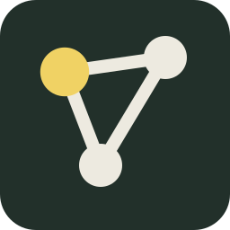

<p align="center">
  
</p>

<h1 align="center">erdostack</h1>

<p align="center">
  <strong>Graph skills for coding agents.</strong><br>
  Graph databases, graph algorithms, data structures and visualization in one vendor-neutral skill profile.<br>
  <a href="https://erdostack.com">erdostack.com</a>
</p>

<p align="center">
  <a href="https://github.com/usergraphtheory/erdostack/actions/workflows/ci.yml"></a>
  <a href="https://github.com/usergraphtheory/erdostack/blob/main/LICENSE"></a>
  <a href="https://github.com/usergraphtheory/erdostack/blob/main/ROADMAP.md"></a>
  <a href="https://agentskills.io"></a>
</p>

```bash
npx skills add usergraphtheory/erdostack
```

> **Status: pre-release.** The packaging, install paths and release pipeline are in place. The skills are not: none have shipped, so today that command has nothing to install, and nothing here has been benchmarked. Skills land in phases, each with eval cases you can run yourself. The [roadmap](https://github.com/usergraphtheory/erdostack/blob/main/ROADMAP.md) has the order.

## Your agent is confidently wrong about graphs

Coding agents write decent application code and then walk into a graph like it owes them money. They write last year's Cypher. They write one engine's Cypher for a different engine. They invent labels, point relationships the wrong way, and ship queries that are fine on 100 nodes and a denial of service on 100 million. Ask for a data model and you get a relational schema in a trench coat.

erdostack is the engine-neutral layer: decide whether you need a graph at all, model it, query it in the right dialect and version, pick the algorithm instead of reinventing it, and avoid melting the database.

It is a set of small, composable [Agent Skills](https://agentskills.io) that you adapt to your repo. It is not a process framework and it does not take over your workflow. Where a database vendor publishes its own skills, erdostack routes to them instead of competing with them.

## What it fixes

| What the agent does | Planned skills | What changes |
|---|---|---|
| **Stale or wrong-engine syntax.** Writes last year's Cypher, writes one engine's Cypher for another, installs the `kuzu` package (archived October 2025) instead of its maintained fork, or assumes SQL/PGQ shipped in PostgreSQL 19 (it was reverted in September 2026) | `query-dialects` | The agent states engine and version, checks support, then writes |
| **Schema hallucination.** Invents labels and properties, reverses relationship direction | `schema-first`, `setup-graph` | Every query is checked against a schema snapshot before it runs |
| **Works on 100 nodes, dies on 100M.** Cartesian products, unbounded variable-length paths, supernode fan-out, no index anchor | `query-review` | The plan is inspected before execution; unbounded patterns are refused or bounded |
| **Graph-shaped hammer.** Reaches for a graph database, or refuses one, without looking at the workload | `graph-or-not` | A short written decision with the cheaper alternatives considered |
| **Tables in a trench coat.** Join tables as nodes, everything as a property, the wrong algorithm reimplemented by hand | `graph-modeling`, `algorithm-picker`, `roast-my-graph` | A model review with named anti-patterns; a library call or engine procedure instead of hand-rolled code |
| **Last-write-wins brain.** Syncs a shared graph by overwriting, leaving dangling edges, resurrected nodes or cycles after concurrent edits | `graph-crdts` | Merge semantics are chosen and written down before any sync code |

Every skill on the roadmap maps to one of these rows. A proposed skill with no row gets cut.

## Who it is for

**For you if** you point a coding agent at a graph database; write Cypher for more than one engine; keep graphs in plain SQL, NetworkX or another in-process library; need to pick a graph algorithm or draw a graph; sync graph-shaped data between replicas; or are trying to work out whether you need a graph database at all.

**Not for you if** you want deep coverage of a single vendor's product (use that vendor's own skills), or a tool that turns your codebase into a knowledge graph (a different and already crowded category).

## Install

The one-liner above uses the open [skills CLI](https://github.com/vercel-labs/skills), which works with Claude Code, Cursor, Codex, Gemini CLI, Copilot, OpenCode and most other agents. Every path below reads the same markdown.

| Host | Command | Model |
|---|---|---|
| Any agent | `npx skills add usergraphtheory/erdostack` | own |
| GitHub CLI | `gh skill install usergraphtheory/erdostack` | own |
| Claude Code | `/plugin marketplace add usergraphtheory/erdostack` then `/plugin install erdostack@erdostack` | subscribe |
| Codex | `codex plugin marketplace add usergraphtheory/erdostack` then `codex plugin add erdostack@erdostack` | subscribe |
| Copilot CLI | `copilot plugin install usergraphtheory/erdostack` | subscribe |
| Gemini CLI | `gemini extensions install https://github.com/usergraphtheory/erdostack` | subscribe |
| Cursor | `npx skills add usergraphtheory/erdostack -a cursor` (marketplace listing to follow) | own |
| npm | `npx erdostack install` (from the first release) | own |
| PyPI | `uvx erdostack install` (from the first release) | own |

**Subscribe or own, not both.** A plugin install *subscribes*: updates arrive when a new version is released. A file install *owns*: the skills are copied into your project and are yours to edit. Pick one per project, or your agent sees two copies of every skill.

**Teams.** Commit the copied skills (for example `.agents/skills/`) so everyone who clones the repo gets them, or register the marketplace in your shared agent settings. [docs/INSTALL.md](https://github.com/usergraphtheory/erdostack/blob/main/docs/INSTALL.md) covers both, plus per-agent directories, pinning and uninstalling.

**No telemetry.** erdostack makes no network calls, collects nothing, runs no install scripts and does not auto-update. The `erdostack` installers on npm and PyPI only copy files. Third-party installers have their own policies: the skills CLI, for one, sends anonymous install telemetry unless you set `DISABLE_TELEMETRY=1`.

<!-- TODO(launch): add a short transcript of roast-my-graph run against a public dataset, and the measured with/without result. -->

## The skills

None of these have shipped yet. **U** is user-invoked: you call it. **M** is model-invoked: the agent picks it up when the task calls for it.

| Skill | Type | Phase | What it does |
|---|---|---|---|
| `roast-my-graph` | U | 1 | **Start here.** Audits a schema, model or query file (graph or relational) and returns real findings with severity and fixes, with jokes. `--serious` drops the jokes |
| `graph-or-not` | U | 1 | Decides between a graph database, an in-process library, recursive SQL, or nothing |
| `setup-graph` | U | 1 | Once per repo: engine, version, driver, how to run queries, read-only or write, where the schema snapshot lives |
| `schema-first` | M | 1 | Introspects before writing; validates labels, types, direction and properties |
| `query-review` | M | 1 | EXPLAIN or PROFILE before running; anti-pattern checks; bounded writes; parameterization |
| `query-dialects` | M | 2 | Version-aware matrix across Cypher 25, openCypher, GQL, SQL/PGQ, Gremlin, SPARQL, AQL and GSQL. The rule: check, do not recall |
| `graph-modeling` | M | 2 | Node, edge or property; reification; supernodes; temporal and versioned graphs; relational to graph |
| `algorithm-picker` | M | 2 | Problem to algorithm to complexity to the library call or engine procedure; exact or approximate |
| `graph-crdts` | M | 2 | Replicated graphs and trees: add and remove semantics, concurrent delete versus edge creation, move operations, tombstones |
| `graphs-in-process` | M | 2 | NetworkX, igraph, rustworkx, graph-tool, GPU options; when to move off each |
| `graphs-in-sql` | M | 2 | Recursive CTEs, adjacency and closure tables, SQL/PGQ where it really exists, Apache AGE, DuckPGQ |
| `graph-import` | U | 3 | Constraints first, idempotent batched loads, id mapping, bulk loaders |
| `graph-migrate` | U | 3 | Engine to engine and relational to graph, with dialect diffs and count and sample verification |
| `graph-testing` | U | 3 | Small deterministic fixture graphs, golden results, containerized engines |
| `graph-evals` | U | 3 | Builds a question-to-query eval set for your own schema; runs with and without skills |
| `graph-rag` | U | 3 | Engine-neutral blueprint: extraction, entity resolution, hybrid retrieval |
| `graph-viz` | M | 3 | Renders a schema or subgraph as Mermaid, DOT or HTML |
| `graph` | U | 3 | Router: picks the right skill once there are enough to need routing |
| `write-graph-skill` | U | 3 | House style for writing your own skills and engine packs |

Skills hand off through files in your repo, so one skill's output is the next one's input: `setup-graph` writes `docs/graph/CONTEXT.md`, `graph-or-not` writes `docs/graph/DECISION.md`, and `roast-my-graph` writes `docs/graph/ROAST.md`.

## Engine packs

Engine-specific detail lives in `references/engines/<engine>.md` and loads only when your repo's `CONTEXT.md` names that engine. Two packs are seeded because both engines run locally with no account:

- **Neo4j**: a server, run in a container.
- **LadybugDB**: the maintained fork of Kuzu. Embedded, in-process, MIT licensed.

The third slot is reserved for the first outside contributor. If you maintain or work on a graph engine, a pack is the highest-value thing you can add. See [CONTRIBUTING.md](https://github.com/usergraphtheory/erdostack/blob/main/CONTRIBUTING.md).

## Honest limits

- **Nothing is measured yet.** There are no skills and no eval results. When there are, they will include the cases where a skill made no difference or made things worse.
- **Skills are instructions, not guarantees.** An agent can still ignore one. `query-review` lowers the odds of an unbounded traversal reaching production. It does not replace query timeouts and read-only credentials.
- **Engine facts go stale.** Every engine claim carries a version and a date for that reason. A pack is only as current as its last check.
- **It is a niche.** If your data has no relationships worth traversing, most of this will not help you. `graph-or-not` exists to tell you so in writing.

## Ground rules

- No inflated install counts, bought stars or planted praise.
- No success stories that cannot be reproduced from the public eval harness.
- No naming that implies a vendor made or endorses a pack. This is independent work.
- No hidden network calls and no undisclosed telemetry. The default is none.
- The roast punches at schemas, never at people.

## Contributing

Fork it, adapt it, and send back what works. Engine packs, eval cases and reports of agent failures that you can reproduce on a public dataset are all welcome, and contributions are credited. Start with [CONTRIBUTING.md](https://github.com/usergraphtheory/erdostack/blob/main/CONTRIBUTING.md).

## The name

Paul Erdős wrote more than 1,500 papers with over 500 coauthors, many of them on graphs, and carried everything he owned in two suitcases. Small, portable and built for collaboration seemed like the right design goals for a skill stack. Installing it will not lower your Erdős number. It might lower your agent's rate of Cartesian products.

## Official sources

An anonymous project is easy to imitate, so this is the whole list. Anything else using the name is not this project.

- Website: [erdostack.com](https://erdostack.com)
- Source: this repository. The [erdostack](https://github.com/erdostack) organization on GitHub is reserved for the project.
- npm: [`erdostack`](https://www.npmjs.com/package/erdostack). PyPI: [`erdostack`](https://pypi.org/project/erdostack/).
- Hugging Face: [erdostack](https://huggingface.co/erdostack), reserved, nothing published yet.
- Announcements: [@graphtheory on X](https://x.com/graphtheory).

The name is one word, lowercase.

## Updates

Release notes are in [CHANGELOG.md](https://github.com/usergraphtheory/erdostack/blob/main/CHANGELOG.md). New failure modes, engine changes and rants are posted at [@graphtheory on X](https://x.com/graphtheory).

## License

[MIT](https://github.com/usergraphtheory/erdostack/blob/main/LICENSE). erdostack is independent and is not affiliated with, sponsored by or endorsed by any database vendor or agent vendor named in this repository. Product names belong to their owners.
